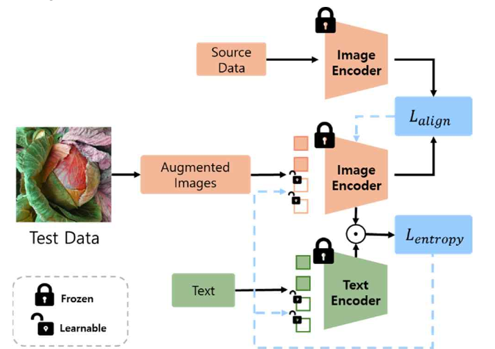

# Zero-Shot Crop Disease Classification with Prompt Tuning & Alignment

> 학습 데이터 없이 처음 보는 환경의 작물 질병을 분류하기 위해, CLIP 기반 비전-언어 모델에 **테스트 시점 프롬프트 튜닝과 분포 정렬**을 적용한 연구

📄 **이소은**, 김찬호, 강병근. *프롬프트 정렬을 활용한 제로-샷 작물 질병 분류 방법*. 2024 한국방송·미디어공학회 추계학술대회 (제1저자)

## 핵심 요약

- 사전 학습된 CLIP을 그대로 쓰면 농업 데이터와의 분포 차이 때문에 Top-1 정확도가 **14.59%**에 그칩니다.
- **TPT(테스트 시점 프롬프트 튜닝) + PromptAlign(분포 정렬)**을 MaPLe 멀티모달 프롬프트에 적용하고, 클래스 프롬프트를 보강해 **Top-1 44.13%, Top-5 83.00%**까지 끌어올렸습니다.
- 질병 데이터로 **별도의 학습을 전혀 하지 않고** 추론 과정만으로 얻은 결과입니다.

## 문제 정의

작물 질병 분류 모델은 대개 특정 데이터로 학습되기 때문에, 새로운 질병이나 다른 기후·토양 환경에서는 성능이 크게 떨어집니다. 모든 질병과 환경마다 데이터를 새로 모으고 학습하는 것은 비용이 큽니다. 그래서 기존 지식만으로 처음 보는 클래스를 분류하는 **제로-샷 학습**과, 테스트 데이터의 분포 변화에 실시간으로 적응하는 방법이 필요합니다.

## 방법

1. **멀티모달 프롬프트 (MaPLe)** — CLIP ViT-B/16의 텍스트·이미지 인코더 양쪽에 학습 가능한 프롬프트 토큰을 넣어 두 모달리티를 함께 조정합니다.
2. **테스트 시점 프롬프트 튜닝 (TPT)** — 테스트 이미지 1장으로 증강 뷰 64개를 만들고, 확신도가 높은 뷰들의 예측 엔트로피를 최소화하도록 프롬프트를 업데이트합니다.
3. **프롬프트 정렬 (PromptAlign)** — 이미지 인코더 각 층의 토큰 임베딩 평균·분산을 소스 데이터 통계와 L1 손실로 맞춰, 데이터셋 간 분포 이동을 줄입니다.
   최종 손실은 `L = L_entropy + β · L_align` (β = 100) 입니다.
4. **클래스 프롬프트 보강**
   - **"Normal" 클래스 확장**: 모든 작물의 정상 상태를 뜻하는 "Normal" 한 단어는 의미가 모호합니다. "Robust", "Energetic", "Alive" 등 관련 단어 23개를 추가하고 그 확률을 Normal 클래스에 합산합니다.
   - **질병 클래스 분할**: "Cabbage Soft Rot"처럼 여러 단어로 된 질병명을 단어 단위로도 인코딩해 해당 클래스 확률에 합산합니다.

## 실험

- **데이터셋**: [AI Hub 노지 작물 질병 진단 이미지](https://www.aihub.or.kr/aihubdata/data/view.do?currMenu=115&topMenu=100&aihubDataSe=realm&dataSetSn=147) — 작물 10종, 약 35만 장, 21개 클래스(정상 1 + 질병 20). 검증용 이미지만 사용
- **설정**: CLIP ViT-B/16 기반 MaPLe(텍스트·이미지 각 2토큰, 3개 층), AdamW, learning rate 0.04

## 결과

| 방법 | Acc-1 | Acc-5 |
|---|---:|---:|
| CLIP (zero-shot) | 14.59 | 38.25 |
| + 프롬프트 튜닝 + 프롬프트 정렬 | 16.75 | 40.58 |
| + "Normal" 관련 프롬프트 추가 생성 | 44.13 | 81.94 |
| + 질병 클래스 분할 | **44.13** | **83.00** |

- 일반 CLIP은 농업 이미지와 사전 학습 데이터의 분포 차이가 커서 정확도가 매우 낮았습니다.
- 가장 큰 개선은 **"Normal" 클래스의 의미를 보강**했을 때 나왔습니다. 프롬프트 설계가 제로-샷 성능에 결정적이라는 점을 보여 줍니다.

## 관련 연구

- 김찬호, **이소은**, 이태형, 강병근. *대조적 언어-이미지 사전 학습 모델을 활용한 비 학습 작물 질병 분류 방법*. 2023 한국방송·미디어공학회 추계학술대회 — 이 연구의 선행 연구로, "Normal" 프롬프트 확장 아이디어를 처음 제안했습니다.
- 같은 데이터셋을 COCO 형식으로 변환한 도구: [convert-to-coco](https://github.com/dlths/conver_to_coco)

## 기술 스택

Python · PyTorch · CLIP (ViT-B/16) · MaPLe · TPT · PromptAlign

## 참고 문헌

- Radford et al., *Learning Transferable Visual Models From Natural Language Supervision* (CLIP), ICML 2021
- Khattak et al., *MaPLe: Multi-modal Prompt Learning*, CVPR 2023
- Shu et al., *Test-Time Prompt Tuning for Zero-Shot Generalization in Vision-Language Models*, NeurIPS 2022
- Abdul Samadh et al., *Align Your Prompts: Test-Time Prompting with Distribution Alignment for Zero-Shot Generalization*, NeurIPS 2023

## Acknowledgment

This work was supported by the Korea Evaluation Institute of Industrial Technology (KEIT) grant funded by the Korea government (MOTIE) (No. 20018635, Development of smart farm management system and growth monitoring).
